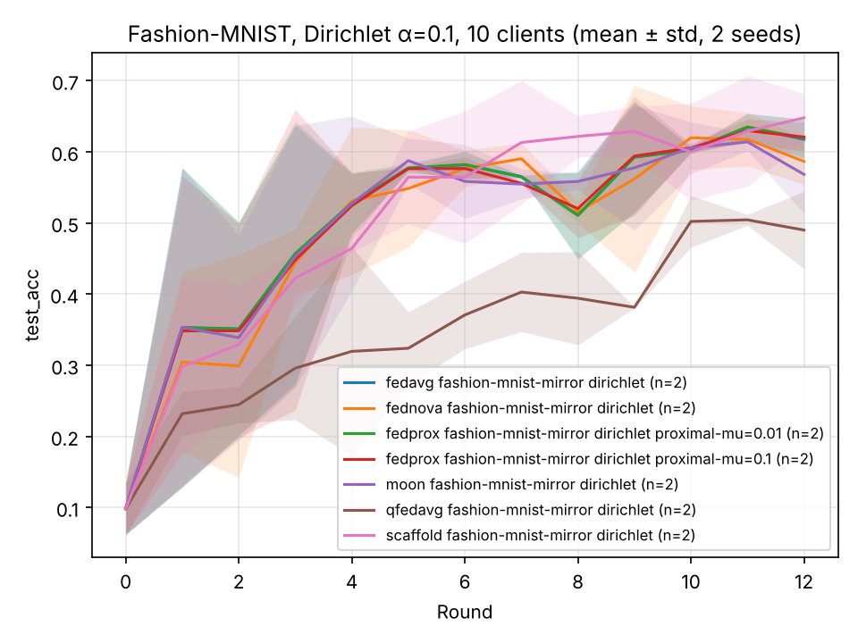

# Experiments

Results of runs made with this repository's code, to show what the implemented algorithms do on real data and how
much of it is noise. Every table is produced by `scripts/run_grid.py` (which calls `scripts/compare.py`); the exact
commands are under each section. Read the caveats first.

## Setup and caveats

| | |
|---|---|
| Machine | 4 CPU cores (Intel Xeon 2.1 GHz), no GPU; Python 3.13, torch 2.14, Flower 1.42 |
| Model | the FedAvg-paper CNN of `defai/task.py` (1.66 M parameters) |
| Data | Fashion-MNIST (`dataset='fashion-mnist-mirror'`, see the README), 60 000 training images split over the clients; 10 000 test images for the `test_acc` of the global model |
| Federation | 10 clients, 5 sampled per round, 1 local epoch, batch size 32, client learning rate 0.01 |
| Seeds | 1 and 2. The seed changes the model initialisation, the data split, the client sampling and the data order |

- **Two seeds are not enough to rank algorithms.** The `±` is the standard deviation over two runs, not a confidence
  interval. Only differences that are large compared to it (and consistent in both seeds) are worth reading.
- **Nothing was tuned.** FedProx μ, MOON μ and q-FedAvg q are the defaults (or the values listed); the learning rate
  is the template's 0.01 for every algorithm. A tuned comparison could rank them differently.
- **The runs are short** (12 rounds) and not converged. The final-round accuracy of a non-IID run jumps by several
  points from round to round, so the tables also show the mean over the last three rounds.
- The accuracy columns are the *global* model on the central test set. `best acc` is the maximum over the rounds,
  i.e. selected on the test set: it is optimistic and only listed for reference.
- `eval_acc_min` is the accuracy of the worst client among the (five) clients evaluated in the last round; it varies
  with which clients were sampled.

## E1: non-IID data (Dirichlet α = 0.1)

Labels are split with `DirichletPartitioner(alpha=0.1)`: a client mostly holds two or three classes
(`python scripts/partition_stats.py --dataset fashion-mnist-mirror --partitioner dirichlet --alpha 0.1 --num-partitions 10 --seed 1`
gives a mean largest-class share of 0.61, uniform would be 0.10) and the clients hold between 755 and 11 442 examples.

```bash
python scripts/run_grid.py --output-dir results/fmnist_noniid --seeds 1 2 --num-supernodes 10 \
  --base "dataset='fashion-mnist-mirror' partitioner='dirichlet' dirichlet-alpha=0.1 num-server-rounds=12" \
  --vary "strategy='fedavg'" "strategy='fedprox' proximal-mu=0.01" "strategy='fedprox' proximal-mu=0.1" \
         "strategy='scaffold'" "strategy='moon'" "strategy='fednova'" "strategy='qfedavg'"
python scripts/compare.py results/fmnist_noniid/*/history.json --tail 3 --extra eval_acc_min comm-mb-total --target 0.6 --markdown
```

| run                                                     | runs | final acc     | last-3 mean   | best acc      | rounds to 0.6 | eval_acc_min  | comm-mb-total    |
| ------------------------------------------------------- | ---- | ------------- | ------------- | ------------- | ------------- | ------------- | ---------------- |
| fedavg                   | 2    | 0.618 ± 0.028 | 0.618 ± 0.004 | 0.648 ± 0.001 | 10.0 (2/2)    | 0.288 ± 0.188 | 761.548 ± 0.000  |
| fednova                  | 2    | 0.587 ± 0.032 | 0.608 ± 0.017 | 0.653 ± 0.002 | 4.5 (2/2)     | 0.171 ± 0.049 | 761.548 ± 0.000  |
| fedprox proximal-mu=0.01 | 2    | 0.619 ± 0.027 | 0.619 ± 0.004 | 0.648 ± 0.000 | 9.5 (2/2)     | 0.288 ± 0.187 | 761.548 ± 0.000  |
| fedprox proximal-mu=0.1  | 2    | 0.621 ± 0.020 | 0.619 ± 0.003 | 0.648 ± 0.008 | 9.5 (2/2)     | 0.293 ± 0.191 | 761.548 ± 0.000  |
| moon                     | 2    | 0.568 ± 0.055 | 0.596 ± 0.026 | 0.631 ± 0.012 | 6.5 (2/2)     | 0.223 ± 0.093 | 761.548 ± 0.000  |
| qfedavg                  | 2    | 0.490 ± 0.054 | 0.499 ± 0.033 | 0.514 ± 0.021 | -             | 0.052 ± 0.065 | 761.548 ± 0.000  |
| scaffold                 | 2    | 0.648 ± 0.034 | 0.626 ± 0.060 | 0.680 ± 0.007 | 6.5 (2/2)     | 0.258 ± 0.091 | 1523.095 ± 0.000 |

(`rounds to 0.6` is the first round whose accuracy reached 0.6, averaged over the runs that did; `comm-mb-total` is the
training traffic of the whole run in MiB.)



`python scripts/plot.py results/fmnist_noniid/*/history.json --group -o docs/figures/e1_noniid.png`: the bands of the
algorithms overlap almost everywhere, FedProx lies on top of FedAvg, and only q-FedAvg is below.

What can and cannot be concluded:

- **FedAvg, FedProx, FedNova, MOON and SCAFFOLD are not separated by these runs.** Their last-3 means lie between
  0.60 and 0.63 and the spread over the two seeds is up to 0.06. SCAFFOLD has the highest `best acc` (0.68), and in
  seed 1 it ends clearly ahead (0.67 against 0.60 for FedAvg), but in seed 2 it ends behind (0.62 against 0.64).
- **FedProx is indistinguishable from FedAvg** for μ = 0.01 and μ = 0.1: the accuracy curves differ by at most 0.004
  (μ = 0.01) and 0.03 (μ = 0.1) in any round, less than the round-to-round jumps. With a learning rate of 0.01 and a
  model that moves little within one epoch, the proximal pull is tiny at these values; larger μ was not tried.
- **q-FedAvg (q = 0.1) is clearly worse** here: 0.50 against 0.62 for FedAvg, in both seeds, and its curve is still
  climbing at round 12. Its update divides by `q·F^(q-1)·‖Δ‖² + L·F^q` with `L = 1/lr`; with lr = 0.01 that
  probably shrinks the step a lot (not verified). It was meant to help the *worst* clients, and it does not here.
- **Traffic is identical for all algorithms except SCAFFOLD**, which sends and receives a control variate next to the
  model: 1523 MiB against 762 MiB.

Caveat for this table: it was produced before commit `6b49a2e` ("Shuffle the mirrored training split before
partitioning"). That fix changes which images a client holds, not how many of each class (checked with
`partition_stats.py`: the class counts are identical), and it was not re-run. Seed 3 of the grid was not run, to save time.


## E3: central differential privacy (adaptive clipping)

MNIST, IID split over 100 clients, 50 sampled per round, 10 rounds, FedAvg with server-side clipping whose norm adapts
to the median update norm (`dp='adaptive'`, target quantile 0.5, initial clip norm 1.0), Gaussian noise with
multiplier `z`, δ = 1e-5. The privacy unit is the client.

```bash
python scripts/run_grid.py --output-dir results/dp --seeds 1 2 --num-supernodes 100 \
  --base "dataset='mnist-mirror' partitioner='iid' num-server-rounds=10" \
  --vary "dp='none'" "dp='adaptive' dp-noise-multiplier=0.5" "dp='adaptive' dp-noise-multiplier=1.0" "dp='adaptive' dp-noise-multiplier=2.0"
python scripts/compare.py results/dp/*/history.json --tail 3 --extra dp-epsilon dp-clip-norm eval_acc_min --target 0.9 --markdown
```

| run                                               | runs | final acc     | last-3 mean   | best acc      | rounds to 0.9 | dp-epsilon     | dp-clip-norm  | eval_acc_min  |
| ------------------------------------------------- | ---- | ------------- | ------------- | ------------- | ------------- | -------------- | ------------- | ------------- |
| fedavg                           | 2    | 0.874 ± 0.005 | 0.861 ± 0.004 | 0.874 ± 0.005 | -             | -              | -             | 0.808 ± 0.012 |
| fedavg DP (z=0.5) | 2    | 0.896 ± 0.004 | 0.885 ± 0.001 | 0.896 ± 0.004 | -             | 48.802 ± 0.000 | 0.415 ± 0.005 | 0.837 ± 0.018 |
| fedavg DP (z=1.0) | 2    | 0.903 ± 0.001 | 0.890 ± 0.001 | 0.906 ± 0.005 | 9.5 (2/2)     | 19.054 ± 0.000 | 0.415 ± 0.005 | 0.833 ± 0.024 |
| fedavg DP (z=2.0) | 2    | 0.825 ± 0.008 | 0.803 ± 0.001 | 0.832 ± 0.002 | -             | 8.079 ± 0.000  | 0.421 ± 0.004 | 0.750 ± 0.000 |

- **ε depends only on `z`, the number of rounds and δ**, not on the data or the seed: 48.8, 19.1 and 8.1 for
  `z` = 0.5, 1, 2. The accountant is the conservative one of this repository (no credit for sampling 50 of 100
  clients per round), so these are upper bounds, but none of them is a strong guarantee. Reaching a small ε needs
  many more clients per round or a much larger `z`.
- **For `z` ≤ 1 the DP runs lost no accuracy in these ten rounds:** 0.90 against 0.87 for FedAvg without DP, in both
  seeds. This is not a claim that DP helps. The baseline is simply not converged (it still gains about 0.01 per
  round) and the adaptive clip norm shrinks from 1.0 to about 0.42; why the clipped runs end ahead was not
  investigated. They are slower at the start (rounds 2 to 4), presumably because the noise scales with the clip norm,
  which starts at 1.0.
- **`z` = 2 costs about 0.07 to 0.08 accuracy** (0.825 against 0.903 at `z` = 1), and the worst client's accuracy
  drops with it (`eval_acc_min` 0.75).
- The noise per coordinate is `z · C / m` = 0.004 to 0.018; with 1.66 M parameters the noise vector is far longer than
  the clipped update, and training still works. That is the usual picture for DP-FedAvg with many clients per round.
- Caveats: ten rounds, IID data, two seeds, one dataset. The numbers say nothing about non-IID data, where clipping
  and noise interact with the heterogeneity.


## E4: update compression

MNIST, IID split over 10 clients, 5 sampled per round, 5 rounds of training (the tables show 6 evaluation points,
round 0 being the untrained model), FedAvg. Clients compress their update just before sending it; the lossy update is
sent dense, and the client reports what the encoded message would have cost.

```bash
python scripts/run_grid.py --output-dir results/compression --seeds 1 2 --num-supernodes 10 \
  --base "dataset='mnist-mirror' partitioner='iid' num-server-rounds=5" \
  --vary "compression='none'" \
    "compression='topk' compression-ratio=0.1" "compression='topk' compression-ratio=0.1 error-feedback=true" \
    "compression='topk' compression-ratio=0.01" "compression='topk' compression-ratio=0.01 error-feedback=true" \
    "compression='quantize' compression-bits=4" "compression='quantize' compression-bits=2"
python scripts/compare.py results/compression/*/history.json --tail 3 --extra compression-error comm-mb-up --target 0.9 --markdown
```

| run | runs | final acc | last-3 mean | rounds to 0.9 | compression-error | upload / round (MiB) |
| --- | --- | --- | --- | --- | --- | --- |
| none (dense float32) | 2 | 0.954 ± 0.006 | 0.945 ± 0.005 | 2.0 (2/2) | - | 31.731 ± 0.000 |
| top-k 10% | 2 | 0.952 ± 0.006 | 0.942 ± 0.006 | 2.5 (2/2) | 0.410 ± 0.001 | 6.345 ± 0.000 |
| top-k 10% + error feedback | 2 | 0.952 ± 0.005 | 0.942 ± 0.005 | 2.0 (2/2) | 0.608 ± 0.028 | 6.345 ± 0.000 |
| top-k 1% | 2 | 0.938 ± 0.005 | 0.922 ± 0.002 | 3.0 (2/2) | 0.729 ± 0.013 | 0.635 ± 0.000 |
| top-k 1% + error feedback | 2 | 0.939 ± 0.005 | 0.927 ± 0.005 | 3.0 (2/2) | 0.879 ± 0.017 | 0.635 ± 0.000 |
| quantize 4 bit | 2 | 0.955 ± 0.006 | 0.945 ± 0.005 | 2.0 (2/2) | 0.627 ± 0.036 | 3.966 ± 0.000 |
| quantize 2 bit | 2 | 0.955 ± 0.006 | 0.945 ± 0.005 | 2.0 (2/2) | 2.537 ± 0.149 | 1.983 ± 0.000 |

(`upload / round` is the traffic from the clients to the server in one round, MiB. `compression-error` is the share
of the compressed update lost to compression, `‖sent − compressed‖ / ‖compressed‖`; with error feedback the compressed
update includes the residual carried over from the previous round.)

- **Quantisation was free in these runs, down to 2 bits.** 4-bit and 2-bit quantisation end at 0.955, like the dense
  runs, with 8 and 16 times less upload (3.97 and 1.98 MiB against 31.7 MiB per round). The `compression-error` is
  large (0.63 and 2.5: at 2 bits the sent update is further from the true one than it is long), but the stochastic
  rounding is unbiased and the noise averages out over five clients. Five rounds of IID MNIST are a gentle test;
  whether this holds near convergence, on non-IID data or with fewer clients per round was not checked.
- **Top-k with 10% of the entries costs about 0.002 accuracy** (within the seed-to-seed spread) for 5 times less
  upload. **Top-k with 1% costs about 0.016** at 50 times less upload, and is visibly slower in the first rounds
  (round 1: 0.67 and 0.79 against 0.86 and 0.87 dense).
- **Error feedback made no measurable difference** here (0.952 against 0.952 and 0.939 against 0.938). It is designed
  to recover what top-k drops over *many* rounds; five rounds are too few to see it, so this says nothing against it.
- Only the upload shrinks: the model sent to the clients is dense. The total traffic of the run (`comm-mb-total`)
  fell from 317 MiB to between 162 and 190 MiB for the top-k runs.
- Compression was not combined with DP here (see the README for how the two interact).
